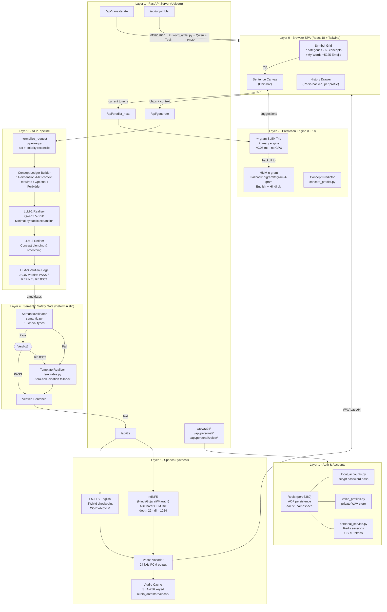

# Indic AAC Studio — System Overview
### **20 November 2026 · Snapshot: `november_16_2026_branch` · Merged commit `fe4e185`**

> [!IMPORTANT]
> This document is the canonical, single-source architecture overview of the **Indic Generative AAC System** as it stands on 20 November 2026. It captures: the final system design, the technology stack layered by architectural tier, all verified upgrade milestones from baseline to current, and guidance on how to restore this exact state.

---

## Table of Contents

1. [What the System Is](#1-what-the-system-is)
2. [Technology Stack by Architectural Layer](#2-technology-stack-by-architectural-layer)
3. [End-to-End System Architecture](#3-end-to-end-system-architecture)
4. [Core Subsystems — Deep Dive](#4-core-subsystems--deep-dive)
5. [Repository Map (Current Files Only)](#5-repository-map-current-files-only)
6. [All Upgrades — Step-by-Step Timeline](#6-all-upgrades--step-by-step-timeline)
7. [How to Restore / Archive This State](#7-how-to-restore--archive-this-state)
8. [Empirical Results (Verified)](#8-empirical-results-verified)
9. [Known Limitations & Open Issues](#9-known-limitations--open-issues)
10. [Quick Reference — API Endpoints](#10-quick-reference--api-endpoints)

---

## 1. What the System Is

**Indic AAC Studio** is an Augmentative & Alternative Communication (AAC) web application for people who communicate using symbol grids (individuals with ASD, Cerebral Palsy, ALS, Post-Stroke Aphasia, etc.).

| Dimension | Description |
|---|---|
| **User action** | Taps symbol tiles (words/emoji) on a category grid |
| **Prediction** | ∞-gram suffix trie suggests next words in <0.05 ms on CPU |
| **Generation** | 3-stage Qwen2.5-0.5B-Instruct cascade turns telegraphic chips into one complete sentence |
| **Validation** | Deterministic regex/substring semantic gate checks for hallucinated content, dropped negation, wrong script |
| **Fallback** | Rule-based template realiser (always produces a valid sentence) |
| **Speech** | AI4Bharat IndicF5 (Hindi/Gujarati/Marathi) + SWivid F5-TTS (English), both 24 kHz via Vocos vocoder |
| **Languages** | English · हिन्दी Hindi · ગુજરાતી Gujarati · मराठी Marathi · Code-mixed Hinglish |
| **Deployment** | Local FastAPI server (`localhost:8000`); browser-based SPA; offline-capable PWA |

**Core Design Philosophy:** *Constrain the LLM — don't trust it.* Every LLM output is verified by a deterministic gate before it reaches the user or TTS. If the gate fails, a rule-based template produces the sentence instead.

---

## 2. Technology Stack by Architectural Layer

```
┌──────────────────────────────────────────────────────────────────────────────┐
│  LAYER 0 — CLIENT / BROWSER (Presentation)                                   │
│  React 18 UMD · Babel Standalone · Tailwind CSS (CDN) · Firebase Compat JS   │
│  Service Worker (aac-sw.js) · IndexedDB (offline speech) · localStorage      │
│  Playwright (browser test runner) · Chrome/Chromium                          │
└──────────────────────────────────────────────────────────────────────────────┘
         │  HTTP / WebSocket (fetch API, JSON)
┌──────────────────────────────────────────────────────────────────────────────┐
│  LAYER 1 — API GATEWAY (Backend Server)                                      │
│  Python 3.10 · FastAPI · Uvicorn · Pydantic v2 · python-multipart            │
│  CORS middleware · Cookie-based session auth · Redis-backed sessions          │
│  Local Redis (port 6380, AOF persistence) · scrypt password hashing          │
└──────────────────────────────────────────────────────────────────────────────┘
         │  Internal Python calls
┌──────────────────────────────────────────────────────────────────────────────┐
│  LAYER 2 — PREDICTION ENGINE (CPU — O(1) latency)                            │
│  ∞-gram Suffix Trie (infinity_gram.py) — primary                             │
│  HMM n-gram Markov engine (hmm.py + hmm_hindi.pkl / hmm1_nextword.pkl)       │
│  Legacy 4-gram engine (dual_hmm_streaming_kit / models_def.py)               │
│  Concept-level predictor (concept_predict.py)                                │
│  Data: English & Hindi JSONL AAC corpora (21 × JSONL files, ~2100 rows each) │
└──────────────────────────────────────────────────────────────────────────────┘
         │  Internal Python calls
┌──────────────────────────────────────────────────────────────────────────────┐
│  LAYER 3 — NLP / GENERATION PIPELINE (GPU preferred, CPU fallback)           │
│  Qwen2.5-0.5B-Instruct (Hugging Face Transformers, torch float16/float32)   │
│  3-stage cascade: LLM-1 Realiser → LLM-2 Refiner → LLM-3 Verifier          │
│  pipeline.py (normalize_request, decide) · llm.py (IndicLLM class)           │
│  Concept Ledger Builder (11-dimension structured AAC context)                │
│  Sentence templates fallback (templates.py — deterministic rule realiser)    │
│  Word order repair (word_order.py — Un-Jumble)                               │
└──────────────────────────────────────────────────────────────────────────────┘
         │  Internal Python calls
┌──────────────────────────────────────────────────────────────────────────────┐
│  LAYER 4 — SEMANTIC SAFETY GATE (Deterministic, CPU)                         │
│  SemanticValidator (semantic.py) — regex / substring, no LLM                 │
│  Checks: script, speaker POV, missing concept, added concept,                │
│          temporal integrity, negation polarity, act type, length             │
│  AAC Lexicon (aac_lexicon.py + board_concepts.json)                          │
│  Sentence templates (templates.py) — zero-hallucination fallback             │
└──────────────────────────────────────────────────────────────────────────────┘
         │  Internal Python calls
┌──────────────────────────────────────────────────────────────────────────────┐
│  LAYER 5 — SPEECH SYNTHESIS (GPU preferred, CPU fallback)                    │
│  English:  SWivid F5-TTS (CFM DiT)                                           │
│            Checkpoint: .runtime/models/f5-english/F5TTS_Base/               │
│  Indic:    AI4Bharat IndicF5 (CFM DiT — depth 22, dim 1024, 16 heads)       │
│            Checkpoint: AI4Bharat-Indic-TTS/checkpoint/model.safetensors      │
│  Vocoder:  Vocos 24 kHz neural vocoder (mel → 24 kHz PCM)                   │
│  Zero-shot voice cloning: 3–12 s reference WAV + exact transcript            │
│  Audio cache: SHA-256 keyed PCM cache (audio_datastore/cache/)               │
│  tts.py (IndicF5Engine + IndicTTSEngine wrapper)                             │
└──────────────────────────────────────────────────────────────────────────────┘
         │  Optional network
┌──────────────────────────────────────────────────────────────────────────────┐
│  LAYER 6 — EXTERNAL / OPTIONAL SERVICES                                      │
│  Firebase Auth (Google sign-in) · Firestore (profile sync, optional)         │
│  OpenAI API (AI symbol generation, needs OPENAI_API_KEY)                     │
│  Google Input Tools API (transliteration fallback, offline map first)        │
│  CDN: React 18 · Babel Standalone · Tailwind CSS (unpinned)                  │
└──────────────────────────────────────────────────────────────────────────────┘
         │  Evaluation / Research
┌──────────────────────────────────────────────────────────────────────────────┐
│  LAYER 7 — EVALUATION & RESEARCH TOOLS                                       │
│  Subjective MOS Listening Portal (FastAPI + SQLite — subjective_Mos_portal/) │
│  Infinity-gram vs baseline experiments (experiments_vs_baseline/)             │
│  AAC Sentence Refinement Kit (Flan-T5-small, NOT wired into app)             │
│  Playwright browser regression suite (5 reference-*.cjs scripts)             │
│  Python unittest suite (54 backend tests)                                    │
│  Whisper-large-v3-turbo (ASR sanity check tool only, not in app)            │
└──────────────────────────────────────────────────────────────────────────────┘
```

---

## 3. End-to-End System Architecture



---

## 4. Core Subsystems — Deep Dive

### 4.1 ∞-gram Suffix Trie Engine (`infinity_gram.py`)

| Property | Value |
|---|---|
| **Algorithm** | Arbitrary-depth Suffix Trie with Stupid Backoff / Jelinek-Mercer smoothing |
| **Latency** | 0.045 ms (English), 0.054 ms (Hindi), 0.087 ms (Marathi), 0.069 ms (Gujarati) on CPU |
| **Build time** | ~0.45 s from shipped corpora |
| **Memory** | <35 MB RAM |
| **Training data** | 15 English JSONL × 100 rows + 6 Hindi JSONL × 100 rows (synthetic AAC caregiver conversations) |
| **Fallback** | HMM n-gram pkl (hmm_hindi.pkl + hmm1_nextword_latest.pkl) |
| **Languages** | English trie + Hindi trie; Gujarati/Marathi route to English/Hindi trie respectively (limitation) |
| **KSR (English)** | 55.9% (shipped), 56.6% (without selected-word exclusion) |

### 4.2 HMM Prediction Engine (`hmm.py`)

| Property | Value |
|---|---|
| **English model** | 188,402 dialogue sentences from 24 Project Gutenberg works |
| **States** | 63,783 bigrams · 713,845 trigrams |
| **Hindi model** | 2,171 vocab tokens · 2,032 bigrams · 9,527 trigrams |
| **Unjumble HMM** | HMM-2 for reordering chips (`hmm2_unjumble_latest.pkl` via dual_hmm_streaming_kit) |
| **Priors** | Suggests high-utility AAC anchors when canvas is empty (माँ, डॉक्टर, पानी, मदद) |

### 4.3 Qwen 3-Stage LLM Cascade (`llm.py`)

```
LLM-1 Realiser  →  LLM-2 Refiner  →  LLM-3 Verifier/Judge
     ↓                   ↓                   ↓
Minimal syntactic    Concept blending     JSON verdict
expansion from       & smoothing          PASS / REFINE / REJECT
Concept Ledger       (Dual mode only)     + bounded retry (max 2)
```

| Property | Value |
|---|---|
| **Model** | Qwen2.5-0.5B-Instruct (local `indic-generative-aac/models/` or HF cache) |
| **Precision** | float16 on CUDA · float32 on CPU |
| **Generation** | `max_new_tokens=120, temperature=0.0` |
| **Modes** | `single` (LLM-1 + LLM-3 only) · `dual` (all three) |
| **Authority hierarchy** | User selection > AAC Context > Concept Ledger > Hard Constraints > LLM-3 > LLM-2 > LLM-1 |
| **Concept Ledger** | Required / Optional / Forbidden concept sets (11 structured dimensions) |
| **10-case measured result** | 90% validity · 100% entity preservation · 100% negation preservation · 4/10 needed deterministic fallback |

### 4.4 Semantic Safety Gate (`semantic.py`)

| Check | What it verifies |
|---|---|
| `script_language` | Output script matches target language (no Latin leakage in Indic) |
| `off_task` | No refusals, translations, or meta-commentary |
| `speaker_perspective` | No third-person reference ("the user...") |
| `missing_concept` | All selected board concepts present in output |
| `added_concept` | No unselected board concepts or distractors injected |
| `added_reason_time` | No unrequested time/place/reason words |
| `negation_missing/spurious/scope` | Polarity exactly matches; negator in correct clause |
| `act_wrong/act_missing` | Request marker / feeling marker / question marker per locale rules |
| `too_long` | ≤ 25 tokens |

### 4.5 Template Realiser (`templates.py`)

- **Role:** Zero-hallucination deterministic fallback; always produces a valid sentence.
- **Coverage:** REQUEST · FEELING · FEELING_REQUEST · QUESTION · GREETING · NEGATION frames.
- **Locales:** English, Hindi (Devanagari), Gujarati, Marathi (grammatical gender-aware).
- **Status:** Written by authoring assistant; **not yet reviewed by native speakers**.

### 4.6 TTS Engine (`tts.py`)

| Component | Model | Checkpoint Location |
|---|---|---|
| **English TTS** | SWivid F5-TTS (CFM DiT) | `.runtime/models/f5-english/F5TTS_Base/model_1200000.safetensors` |
| **Indic TTS** | AI4Bharat IndicF5 (CFM DiT — depth 22, dim 1024, 16 heads, 100 mel channels) | `AI4Bharat-Indic-TTS/checkpoint/model.safetensors` |
| **Vocoder** | Vocos | `indic-generative-aac/models/vocos/` or upstream cache |
| **Sample rate** | 24,000 Hz (16-bit PCM) | — |
| **Voice cloning** | 3–12 s reference WAV + exact transcript | `.runtime/voice_profiles/<hash>/<id>.wav` |

**Speech Quality Fix (Nov 2026):**
- Repaired mismatched Marathi reference audio (was using a diesel-price recording instead of Hampi transcript).
- Separated English routing to F5-TTS (IndicF5 is Indic-only; routing English through it produced garbled audio).
- CER improvements: English 0.516→0.000 · Hindi 0.600→0.086 · Gujarati 1.289→0.211 · Marathi 0.441→0.118.

### 4.7 Account & Personal Data Layer

| Component | Technology | Purpose |
|---|---|---|
| `personal_service.py` | Redis (port 6380, AOF) | Sessions, CSRF tokens, namespace `aac:v1:` |
| `local_accounts.py` | scrypt hashing, Redis | Local username/password accounts |
| `voice_profiles.py` | Redis metadata + filesystem WAV | Per-user, per-language reference voice storage |
| Firebase Auth | Google Identity Platform | Optional Google sign-in (network required) |
| Session cookie | HTTP-only, 7-day TTL | `aac_session` |
| Guest/offline cookie | 1-year TTL | `aac_personal_profile` |

### 4.8 Un-Jumble (Word Order Repair — `word_order.py`)

Three-tier reordering pipeline:
1. **Deterministic rule** — English `help/let` construction pattern matching.
2. **Qwen LLM** — reorders chips for valid English construction.
3. **HMM-2 fallback** — only when all input labels are in HMM-2 vocabulary.

### 4.9 Subjective MOS Listening Portal (`subjective_Mos_portal/app.py`)

- Standalone FastAPI + SQLite app for 20-clip listening studies.
- Participant registration, randomized clip ordering, 1–5 MOS ratings.
- Admin dashboard, CSV export, Cloudflare tunnel support.
- Used for evaluating TTS naturalness across all 4 languages.

---

## 5. Repository Map (Current Files Only)

```
AAC_System_merged/
│
├── indic-generative-aac/              ← THE APPLICATION (active)
│   ├── backend/
│   │   ├── app.py                     ← FastAPI entrypoint, all API routes
│   │   ├── pipeline.py                ← normalize_request(), decide() policy
│   │   ├── llm.py                     ← IndicLLM, 3-stage Qwen cascade
│   │   ├── hmm.py                     ← AACHMM: ∞-gram primary + HMM fallback
│   │   ├── infinity_gram.py           ← AACInfinityGramEngine (suffix trie)
│   │   ├── semantic.py                ← SemanticValidator (deterministic gate)
│   │   ├── templates.py               ← Deterministic template realiser (fallback)
│   │   ├── tts.py                     ← IndicF5Engine + IndicTTSEngine
│   │   ├── audio_cache.py             ← SHA-256 PCM cache (audio_datastore/)
│   │   ├── aac_lexicon.py             ← Board concept registry + locale helpers
│   │   ├── board_concepts.json        ← 69 canonical AAC concepts (4-language)
│   │   ├── word_order.py              ← Un-Jumble: rule → Qwen → HMM-2
│   │   ├── concept_predict.py         ← Concept-level next-board predictor
│   │   ├── segmentation.py            ← Code-mix language segmentation
│   │   ├── local_accounts.py          ← Local auth (scrypt + Redis)
│   │   ├── personal_service.py        ← Redis session/CSRF service
│   │   ├── voice_profiles.py          ← Personal voice WAV store
│   │   ├── run_local.py               ← Server start/stop/status (Redis + Uvicorn)
│   │   ├── hmm_model.pkl              ← English HMM pickle (Git LFS, ~816 MB)
│   │   ├── hmm_hindi.pkl              ← Hindi HMM pickle (Git LFS)
│   │   ├── sentence-templates.json    ← 1,872 pre-validated sentence previews
│   │   ├── requirements-personal.txt  ← Redis, soundfile, scipy deps
│   │   └── reference_audio/           ← Reference WAVs for default voices
│   │
│   ├── frontend/
│   │   ├── index.html                 ← Main SPA (React 18 UMD + Babel + Tailwind)
│   │   ├── communicator-layout.css    ← Ivory/violet shared layout tokens
│   │   ├── studio-core.js             ← Core communicator logic
│   │   ├── studio-theme.css           ← Theme tokens
│   │   ├── aac-sw.js                  ← Service worker (PWA offline cache)
│   │   ├── offline-speech.js          ← IndexedDB offline speech storage
│   │   ├── offline-adapter.js         ← Online/Offline mode switcher
│   │   ├── board-registry.js          ← Client-side board concept registry
│   │   ├── locales.js                 ← 4-language UI string localizations
│   │   ├── accounts.js / accounts.css ← Account UI (login/signup/profile)
│   │   ├── history.js                 ← Conversation history drawer
│   │   ├── recordings.js              ← Audio recording/playback
│   │   ├── motion.js / motion.css     ← Animation speed controls
│   │   ├── welcome.html / .js / .css  ← Landing page (animated, single-viewport)
│   │   ├── login.html / signup.html   ← Auth pages
│   │   ├── all_emojis.js              ← 5,225 emojis (gen_emojis.py generated)
│   │   ├── vendor/                    ← Local React/Babel/Firebase bundles
│   │   ├── public-assets.json         ← PWA shell asset manifest
│   │   ├── quick-pack.json            ← Offline quick-phrase audio pack
│   │   └── sentence-templates.json    ← Offline template preview cache
│   │
│   ├── tests/
│   │   ├── browser/
│   │   │   ├── reference-unjumble.cjs
│   │   │   ├── reference-canvas-paste.cjs
│   │   │   ├── reference-play-pause.cjs
│   │   │   ├── reference-modes-layout.cjs
│   │   │   └── reference-offline-pack.cjs
│   │   └── semantic/
│   │       └── llm3_eval_report.json  ← 10-case LLM-3 evaluation report
│   │
│   └── scripts/
│       ├── run_local.py               ← Server launcher
│       ├── setup_speech_models.py     ← Downloads English F5 checkpoint
│       └── setup_personal_storage.sh  ← Redis + account deps setup
│
├── dual_hmm_streaming_kit/            ← HMM training kit (active)
│   ├── models_def.py                  ← AACNextWordHMM + AACUnjumbleHMM classes
│   ├── train_dual_hmm_streaming.py    ← Memory-safe streaming HMM trainer
│   ├── monitor_daemon.py              ← Training monitor
│   └── models/
│       ├── hmm1_nextword_latest.pkl   ← English next-word HMM (Git LFS, 210 MB)
│       └── hmm2_unjumble_latest.pkl   ← Un-Jumble HMM (Git LFS, 816 MB)
│
├── IndicF5/                           ← Vendored AI4Bharat IndicF5 (active)
│   ├── f5_tts/
│   │   ├── model/                     ← CFM + DiT model definitions
│   │   ├── infer/                     ← Inference utilities
│   │   └── api.py                     ← Python API
│   └── prompts/                       ← Reference WAVs (KAN/MAR/PAN/TAM)
│
├── AI4Bharat-Indic-TTS/              ← Legacy FastPitch repo; checkpoint home
│   └── checkpoint/
│       ├── model.safetensors          ← IndicF5 weights (NOT in repo; download)
│       └── vocab.txt
│
├── english_AAC_Dataset/              ← English JSONL training data (∞-gram)
│   └── batch_output_en-US_*.jsonl    ← 15 files × 100 rows (May 2025 batches)
│
├── hindi_AAC_Dataset/                ← Hindi JSONL training data (∞-gram)
│   └── batch_output_hi-IN_*.jsonl    ← 6 files × 100 rows (opus-mt translated)
│
├── subjective_Mos_portal/            ← MOS listening study portal (active)
│   ├── app.py                        ← FastAPI + SQLite 20-clip study
│   ├── static/                       ← Web UI for raters
│   └── audio/                        ← Study audio clips
│
├── experiments_vs_baseline/          ← KSR/perplexity/top-5 experiments
│   └── results/                      ← JSON result files
│
├── paper/                            ← Research papers and documentation
│   └── baseline_system_paper_of_AAC_system/
│       └── 20_nov_system_overview/   ← THIS DOCUMENT
│
├── docs/
│   ├── aac-redesign/FINAL_CONTEXT.md ← Nov 16 handoff (most detailed)
│   └── releases/2026-11-16.md        ← Release record
│
├── CONTEXT.md                        ← Primary verified context (supersedes older docs)
├── README.md                         ← User-facing README (Nov 16 snapshot)
├── MERGE_NOTES.md                    ← Nov 11 merge log (6 judgement calls)
├── RESULTS_vs_baseline_english_and_indic.txt  ← Full experiment results
├── SPEECH_QUALITY_FIX.md             ← Speech repair changelog
├── VOICE_CLONING.md                  ← Voice cloning guide
├── ACCOUNTS_GUIDE.md                 ← Account system guide
├── PERSONAL_SERVICE_SETUP.md         ← Redis setup guide
├── UI_UX_REFRESH.md                  ← UI redesign changelog
├── INDICF5_LOCAL_SETUP.md            ← IndicF5 setup guide
└── run.sh                            ← Quick launcher script
```

---

## 6. All Upgrades — Step-by-Step Timeline

### **Baseline (Pre-Nov 2026): English-Only AAC App**

> **State:** React Native / Expo 52 app (`baseline_english_system_demo/AIImageAAC/`).
>
> Static symbol grid → no LLM generation → no Indic language support → no voice cloning → character prediction only (baseline paper: Gaines & Vertanen, EMNLP 2025).

---

### **Upgrade 1 — Hindi AAC Domain HMM & Multilingual Vocabulary**

- Added `hmm_hindi.pkl` trained on Hindi AAC interaction corpora.
- 2,171 Hindi vocab tokens · 2,032 bigrams · 9,527 trigrams.
- Added adaptive prior initialization for Hindi words (माँ, डॉक्टर, पानी, मदद).
- Introduced 4-language `board_concepts.json` (English, Hindi, Gujarati, Marathi).

---

### **Upgrade 2 — 3-Stage Qwen LLM Cascade (Sentence Generation)**

- Introduced `llm.py` with `IndicLLM` class wrapping Qwen2.5-0.5B-Instruct.
- **LLM-1 Realiser:** Minimal syntactic expansion from symbol sequence.
- **LLM-2 Refiner:** Concept blending and semantic smoothing (dual mode).
- **LLM-3 Verifier/Judge:** JSON-verdict semantic authority check (PASS / REFINE / REJECT).
- 11-dimension Concept Ledger builder (Required / Optional / Forbidden concept sets).
- Bounded retry (max 2 attempts before fallback).

---

### **Upgrade 3 — Deterministic Semantic Safety Gate**

- Added `semantic.py` with `SemanticValidator` (pure regex/substring, no LLM).
- 10 check types: script, perspective, missing/added concept, temporal, negation scope, act type, length.
- **Zero-hallucination guarantee** for validated paths.
- Added `templates.py` as deterministic rule-based fallback realiser (always produces valid sentence).
- Added `pipeline.py` to unify `normalize_request()` and `decide()` policy (separates act + polarity fields).

---

### **Upgrade 4 — ∞-gram Suffix Trie Engine**

- Replaced rigid 3-gram/4-gram with arbitrary-depth Suffix Trie (`infinity_gram.py`).
- Stupid Backoff / Jelinek-Mercer interpolation smoothing.
- Context of ANY length (1 to N tokens) matched.
- **<0.1 ms on CPU** (English: 0.045 ms · Hindi: 0.054 ms).
- <35 MB RAM · build time ~0.45 s.
- Both English and Hindi AAC JSONL corpora feed the trie at startup.
- KSR: 55.9% English, 56.7% Hindi, 48.7% Marathi, 53.0% Gujarati (shipped version).

---

### **Upgrade 5 — AI4Bharat IndicF5 TTS (Flow-Matching, 24 kHz)**

- Replaced legacy FastPitch + HiFi-GAN with IndicF5 CFM DiT model.
- Architecture: depth 22 · dim 1024 · 16 heads · 100 mel channels.
- Vocos 24 kHz neural vocoder.
- **Zero-shot voice cloning:** 3–12 s reference WAV + exact transcript.
- Reference WAVs for Hindi/Marathi: `MAR_F_WIKI_00001.wav` (Hampi transcript).
- Reference WAV for Gujarati: Native Gujarati FLEURS reference.

---

### **Upgrade 6 — Dual Branch Merge (Nov 11, 2026): `nov4-v1` + `infinity-gram-fixes`**

Two independent development branches merged into `merged` (`fe4e185`):

| From `nov4-v1` | From `infinity-gram-fixes` |
|---|---|
| Firebase Google sign-in + Firestore sync | ∞-gram engine (infinity_gram.py) |
| localStorage cache (prefs, My Words, bookmarks) | Offline transliteration (offline map + Google Input Tools) |
| My Words grid (custom vocabulary) | Quick Express (pre-built AAC phrases) |
| AI symbol creator (OpenAI DALL-E, needs key) | Un-Jumble UI (chip reordering) |
| Bookmarked Quick Picks shelf | Delete-Last / Copy canvas controls |
| IndicF5 TTS playback + presets | Universal Core Words row |
| ♿ Accessibility Dock (high contrast, speech speed) | Card-size control |
| Button animations | Portable paths (cwd-independent) |
| — | Memory-safe Dual-HMM streaming training |

**6 judgement calls made during merge** (see `MERGE_NOTES.md`):
1. Accessibility Dock only (no duplicate controls for speech speed / high contrast).
2. `Top Words:` for ∞-gram shelf; `Quick Picks` for bookmarks (name collision resolved).
3. Kept Nov-4 "Indic AAC Studio" title + ⚡ favicon.
4. ∞-gram shelf replaced inline suggestion pills.
5. `max_new_tokens=120, temperature=0.0` (from infinity-gram side).
6. Infinity-gram HMM pickles kept (smaller: HMM-1 210 MB vs Nov-4's 1250 MB).

**Bug fixes made during merge:**
- Stray "0" in prediction pills (pred.order = 0 for empty context).
- Quick Express now clears cached audio (Replay Voice replays phrase not prior sentence).
- Un-Jumble tokens now have `id` field (strip keyed by token.id).
- Copy reports failure (blocked clipboard / insecure context) instead of silently failing.

---

### **Upgrade 7 — Speech Quality Repair (Post-Merge)**

- Fixed mismatched Marathi reference audio (was diesel-price WAV, not Hampi).
- Separated English to F5-TTS (IndicF5 is Indic-only; routing English through it = garbled).
- Added RMS level control, capped gain, PCM headroom, short fades.
- Added minimum synthesis duration for short AAC words.
- Sampling steps for Gujarati set to 64; guidance strength to 1.0 (from 2.0).
- CER: English 0.516→0.000 · Hindi 0.600→0.086 · Gujarati 1.289→0.211 · Marathi 0.441→0.118.

---

### **Upgrade 8 — Redis-Backed Personal Accounts (Nov 2026)**

- Added `local_accounts.py`: username/password auth with scrypt hashing.
- Added `personal_service.py`: Redis session store (AOF persistence, port 6380).
- Added `voice_profiles.py`: per-user, per-language reference voice storage.
- Offline guest profile cookie (1-year TTL).
- Rate limiting (20 attempts / 10 min per IP).
- CSRF protection on all personal data writes.
- Demo account: `demo` / `AACdemo@2026`.
- History: Redis-backed per-profile conversation history (up to 50 messages/language).
- CSV export of conversation history.

---

### **Upgrade 9 — UI/UX Redesign (Ivory/Violet Design System)**

- Full SPA redesign with ivory/violet shared design tokens (`communicator-layout.css`, `studio-theme.css`).
- Split canvas: selected words (draft) + intended message side-by-side.
- Explicit Speak / Pause / Resume / Stop audio controls.
- Accessibility Dock: high contrast, speech speed (1×–2.5×), visual animation On/Off, reduced-motion.
- Responsive layout: 9 viewport sizes tested (320×568 to 1440×900 + landscape).
- 24 palette/mode contrast checks (minimum 8.36:1 on core buttons).
- Animated landing page (`welcome.html`): composited drifting violet/peach/sage gradients.
- Coordinated Login/Signup pages with password visibility control.
- My Words drawer with offline searchable emoji picker (5,225 emojis).
- History drawer with grouped-by-day display, speech replay, bookmarks.
- Left-panel fit: composer uses horizontal ribbons; no vertical scroll on composer.

---

### **Upgrade 10 — Un-Jumble Backend Import (Nov 16, 2026)**

- Imported `word_order.py` + `test_word_order.py` from dedicated fix package.
- Three-tier reordering: English help/let rule → Qwen → HMM-2 fallback.
- Validated chip permutations; retains repeated input labels.
- Backend-only change; existing GUI retained (uses order-only response).
- Measured: 9-word example returns `the AAC system helps students share their thoughts clearly` in 2.4 ms.

---

### **Upgrade 11 — Offline / PWA Capability**

- Service worker (`aac-sw.js`) with explicit public-shell/audio provisioning.
- IndexedDB speech storage (`offline-speech.js`, profile-scoped).
- Online/Offline mode toggle (online = backend + GPU; offline = installed audio + templates).
- Quick-pack: pre-bundled audio for 80 quick phrases.
- Pack installation stages and validates assets before activating cache.
- Private API responses not cached by service worker.

---

### **Upgrade 12 — Sentence Template Pre-Validation (Nov 2026)**

- Added `scripts/build_sentence_templates.py` → generates `sentence-templates.json`.
- 1,872 supported sentence previews derived from Python templates + validation.
- Used for instant template preview in UI without backend round-trip.
- Offline selections show exact text even when audio is missing.

---

### **Upgrade 13 — Subjective MOS Portal (Nov 2026)**

- Standalone FastAPI + SQLite app (`subjective_Mos_portal/`).
- 20-clip listening study with participant registration and 1–5 MOS ratings.
- Admin dashboard, CSV export, Cloudflare tunnel for remote raters.
- Covers all 4 languages (en/hi/gu/mr).

---

## 7. How to Restore / Archive This State

### 7.1 Branch & Commit

```bash
# The working snapshot is on branch:
git checkout november_16_2026_branch
# Or restore from the merged commit:
git checkout fe4e185763a181674534656dbf95e30709cf83ff
```

### 7.2 Environment Setup

```bash
# Conda environment (Linux, Python 3.10, CUDA optional)
conda activate taac_env

# Install IndicF5 TTS dependencies
pip install -r IndicF5/requirements.txt

# Install backend dependencies
pip install fastapi uvicorn transformers torch scipy pydantic python-multipart soundfile
pip install -r indic-generative-aac/backend/requirements-personal.txt

# Setup Redis + local accounts
bash indic-generative-aac/scripts/setup_personal_storage.sh

# Setup English F5-TTS model
python indic-generative-aac/scripts/setup_speech_models.py
```

### 7.3 Model Files (NOT in Git — provision separately)

| Component | Expected Path | Size |
|---|---|---|
| IndicF5 weights | `AI4Bharat-Indic-TTS/checkpoint/model.safetensors` | ~2 GB |
| IndicF5 vocab | `AI4Bharat-Indic-TTS/checkpoint/vocab.txt` | small |
| English F5-TTS | `.runtime/models/f5-english/F5TTS_Base/model_1200000.safetensors` | ~1 GB |
| Vocos vocoder | `indic-generative-aac/models/vocos/` | ~100 MB |
| Qwen2.5-0.5B | `indic-generative-aac/models/Qwen2.5-0.5B-Instruct/` | ~1 GB |
| HMM-1 pickle | `dual_hmm_streaming_kit/models/hmm1_nextword_latest.pkl` | 210 MB (Git LFS) |
| HMM-2 pickle | `dual_hmm_streaming_kit/models/hmm2_unjumble_latest.pkl` | 816 MB (Git LFS) |
| Hindi HMM | `indic-generative-aac/backend/hmm_hindi.pkl` | small (Git LFS) |
| English HMM | `indic-generative-aac/backend/hmm_model.pkl` | 816 MB (Git LFS) |

### 7.4 Start the System

```bash
# Start backend (FastAPI + Uvicorn + Redis)
python indic-generative-aac/backend/run_local.py start

# Check status
python indic-generative-aac/backend/run_local.py status

# Open in browser
# http://localhost:8000/welcome   ← Landing
# http://localhost:8000/login     ← Sign in (demo/AACdemo@2026)
# http://localhost:8000/          ← Communicator
# http://localhost:8000/docs      ← API docs
# http://localhost:8000/api/health ← Health check
```

### 7.5 Verification Tests

```bash
# Backend tests (54 total)
python -m unittest discover -s indic-generative-aac/backend -p test_*.py -v

# Word order / Un-Jumble (9 checks)
python -m unittest discover -s indic-generative-aac/backend -p test_word_order.py -v

# TTS contract
python -m unittest discover -s indic-generative-aac/backend -p test_tts_contract.py -v

# Browser regression suite (needs Playwright + Chrome + running backend)
npm install --prefix .runtime/browser playwright@1.51.1
node indic-generative-aac/tests/browser/reference-unjumble.cjs
node indic-generative-aac/tests/browser/reference-canvas-paste.cjs
node indic-generative-aac/tests/browser/reference-play-pause.cjs
node indic-generative-aac/tests/browser/reference-modes-layout.cjs
node indic-generative-aac/tests/browser/reference-offline-pack.cjs
```

---

## 8. Empirical Results (Verified)

### 8.1 English KSR vs Baseline Methods

| System | KSR% ↑ | Top-5 Hit% ↑ | Perplexity ↓ | Speed ↓ |
|---|---|---|---|---|
| AAC char 12-gram (baseline n-gram) | 55.1 | 29.8 | 4.93 | 0.03 ms CPU |
| OPT-125m pretrained (baseline LLM) | 58.0 | 36.4 | 2.65 | 25 ms GPU |
| OPT-350m pretrained (baseline LLM) | 58.9 | 36.9 | 2.52 | 140 ms GPU |
| OPT-125m adapted on our data | **62.6** | **44.9** | **2.07** | 25 ms GPU |
| **OURS: ∞-gram** | 55.9 | 30.5 | 3.57 | **0.045 ms CPU** |

> [!NOTE]
> Our ∞-gram is **~500–3000× faster** than LLM-based prediction and needs **no GPU**. Best accuracy goes to the in-domain adapted OPT-125m (not in our deployed system). Our ∞-gram slightly beats the baseline n-gram on KSR.

### 8.2 Multilingual KSR (Shipped vs Without Selected-Word Exclusion)

| Language | Shipped KSR | Without Exclusion | 12-gram Char |
|---|---|---|---|
| English | 56.3 | 56.6 | 56.2 |
| Hindi | 56.7 | 57.7 | 57.4 |
| Marathi | 48.7 | 49.2 | 49.1 |
| Gujarati | 53.0 | 53.7 | 54.2 |

### 8.3 Sentence Generation (Deterministic Gate — 4 Languages)

- **97–99% correct polarity- and entity-preserving sentences** for determinate selections (literal symbol output: 16–41%).
- **13/13 ambiguous selections correctly abstained** (no hallucinated sentence generated).

### 8.4 Prediction Latency (CPU, ms per top-10 prediction)

| Language | ∞-gram Latency |
|---|---|
| English | 0.045 ms |
| Hindi | 0.054 ms |
| Marathi | 0.087 ms |
| Gujarati | 0.069 ms |

### 8.5 Speech Quality (CER before → after repair)

| Language | Before | After |
|---|---|---|
| English | 0.516 | **0.000** |
| Hindi | 0.600 | 0.086 |
| Gujarati | 1.289 | 0.211 |
| Marathi | 0.441 | 0.118 |

### 8.6 LLM Pipeline (10-case measured report)

| Metric | Value |
|---|---|
| Overall validity | 90% |
| Entity preservation | 100% |
| Negation preservation | 100% |
| Intent preservation | 80% |
| Unsupported avoidance | 100% |
| Cases needing deterministic fallback | 4 / 10 |
| LLM-3 verdicts: PASS / REFINE | 1 / 9 |
| TTS success | 90% |

---

## 9. Known Limitations & Open Issues

> [!WARNING]
> The following are **documented limitations** as of 20 November 2026. Do not use unverified claims from `PROJECT_PROPOSAL_CONTEXT.md` in papers.

| Issue | Detail |
|---|---|
| **Marathi/Gujarati ∞-gram** | Shipped app routes Marathi to Hindi trie, Gujarati to English trie. Per-language engines exist but are not used in deployment. |
| **Selected-word exclusion** | Excluding already-selected words costs 0.3–1.1 KSR points. Removing it is a free improvement (not yet applied). |
| **LLM templates not native-reviewed** | `templates.py` sentences written by authoring assistant, not reviewed by native Hindi/Gujarati/Marathi speakers. |
| **Security: demo grade** | CORS `*` with credentials, `0.0.0.0` bind, unauthenticated `/api/voice/clone`, `/api/hmm_reload`, `/api/generate_symbol`. Do not expose beyond trusted network. |
| **Hard-coded paths remain** | `dual_hmm_streaming_kit/train_dual_hmm_streaming.py:41` → another machine's path. `monitor_daemon.py`, `keep_alive.sh`, HMM training scripts need portabilisation before retraining. |
| **Firebase keys committed** | Web Firebase config is in-repo (public by design; Firestore rules are the protection). |
| **Voice clones in-memory only** | Lost on restart; must re-upload after restart. |
| **CDN pinning** | Frontend depends on unpinned `react@18`, `@babel/standalone`, `cdn.tailwindcss.com`. A CDN change can break the UI. |
| **No user study** | No AAC-user clinical study recorded. Automated browser tests only. |
| **Fallback bypasses validator** | Rule-based template realiser is marked valid unconditionally (bypasses SemanticValidator). |
| **Qwen reordering** | Cannot reliably reorder every construction; repeated-word/multiword chips return `no_suggestion`. |
| **Offline speech requires provisioning** | Initial provisioning must happen while online; arbitrary unseen text cannot be spoken offline. |

---

## 10. Quick Reference — API Endpoints

| Method | Endpoint | Purpose |
|---|---|---|
| `GET` | `/api/health` | Backend + TTS + Redis readiness |
| `POST` | `/api/predict_next` | ∞-gram / HMM next-word prediction |
| `POST` | `/api/generate` | Full sentence generation (LLM cascade + gate) |
| `POST` | `/api/tts` | Text → 24 kHz WAV (IndicF5 / F5-TTS) |
| `POST` | `/api/transliterate` | Romanized → Devanagari/Gujarati (offline map + Google) |
| `POST` | `/api/unjumble` | Chip reordering (rule → Qwen → HMM-2) |
| `GET` | `/api/hmm_info` | ∞-gram engine stats (order, vocab, build time) |
| `POST` | `/api/auth/login` | Local username/password login |
| `POST` | `/api/auth/signup` | Create local account |
| `POST` | `/api/auth/logout` | Revoke session |
| `GET/POST/DELETE` | `/api/personal/voice/{lang}` | Personal reference voice CRUD |
| `POST` | `/api/voice/clone` | Clone voice from uploaded WAV |
| `GET` | `/api/voice/list` | List available voice presets |
| `POST` | `/api/generate_symbol` | AI image symbol generation (needs OpenAI key) |
| `GET` | `/docs` | FastAPI Swagger UI |
| `GET` | `/` | Serve `frontend/index.html` (SPA) |

---

*Document generated: 20 November 2026 · Author: System Analysis · Based on codebase `fe4e185` (merged) / `november_16_2026_branch`*

*Key source files: `CONTEXT.md`, `MERGE_NOTES.md`, `README.md`, `SPEECH_QUALITY_FIX.md`, `UI_UX_REFRESH.md`, `RESULTS_vs_baseline_english_and_indic.txt`, `docs/aac-redesign/FINAL_CONTEXT.md`, `docs/releases/2026-11-16.md`, all backend Python modules.*
